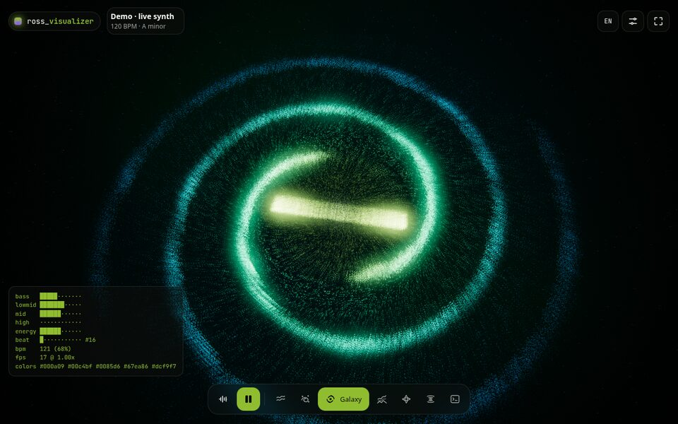

# ross_visualizer

**Tu música, hecha luz.** Un visualizer de música en tiempo real para el navegador: los colores salen de la portada y el movimiento sale del sonido.

**Demo → [visualizer.rossmel.com](https://visualizer.rossmel.com)** · [English](README.md)



## Qué hace

- **Buscas cualquier canción** y suena su vista previa de 30 s (API de búsqueda de iTunes, sin iniciar sesión), mientras las escenas toman la paleta de su portada.
- **O escucha tu propio audio**: el micrófono, el audio de tu PC (en Chrome/Edge, compartiendo pantalla con "Compartir audio"), un archivo local (lee la portada incrustada en las etiquetas MP3/FLAC) o una pista sintetizada que viene incluida.
- **Siete escenas** con transición entre ellas: gotas de tinta mezclándose en agua (una simulación de advección de verdad), una nebulosa de gas y polvo, una galaxia de 120 mil partículas que cambia entre espiral, barrada, anillo y elíptica, una aurora boreal sobre un lago, un caleidoscopio hecho con la portada, un túnel tipo queso que se divide en agujeros y una terminal que dibuja el espectro en ASCII.
- Funciona en el celular: deslizas para cambiar de escena, se instala como PWA y no deja que la pantalla se apague.

No se sube nada: todo el análisis de audio ocurre en tu navegador.

## Cómo funciona

- **Audio** (`src/audio/features.ts`): cuatro bandas con control automático de ganancia, detección de beats por *spectral flux* en el rango del bombo (40–160 Hz) con umbral adaptativo, y tempo estimado con un histograma de intervalos entre golpes.
- **Paleta** (`src/color/palette.ts`): la portada se reduce a 64×64, se agrupa con k-means en **OKLab** (un espacio de color perceptual) y los grupos se puntúan para llenar cinco roles: fondo, primario, secundario, acento y brillo. Las portadas apagadas conservan su tono; las de blanco y negro usan el lima de la marca como acento.
- **Render** (`src/gl/`): WebGL2 con bloom, tonemapping ACES y resolución adaptativa. Los shaders son GLSL ES 3.00 para poder reutilizarlos en Android.

## Correrlo

```sh
npm install
npm run dev      # http://127.0.0.1:5190
npm test
npm run build
```

## Teclas

`1`–`7` escenas · `←`/`→` · `Espacio` reproducir/pausar · `F` pantalla completa · `H` ocultar la interfaz · `/` buscar

## Lo que viene

- App de escritorio (Tauri) con modo **overlay** transparente y captura nativa del audio del sistema.
- App de Android con modo overlay, leyendo la sesión multimedia del sistema.
- Más escenas.

Hecho por [Rossmel Abasto](https://portfolio.rossmel.com) · Licencia MIT
