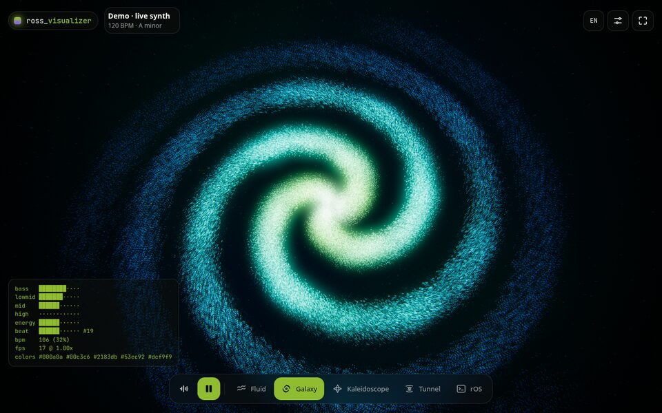

# ross_visualizer

**Tu música, hecha luz.** Un visualizer de música en tiempo real para el navegador: los colores salen de la portada y el movimiento sale del sonido.

**Demo → [visualizer.rossmel.com](https://visualizer.rossmel.com)** · [English](README.md)



## Qué hace

- **Buscas cualquier canción** y suena su vista previa de 30 s (API de búsqueda de iTunes, sin iniciar sesión), mientras las escenas toman la paleta de su portada.
- **O escucha tu propio audio**: el micrófono, el audio de tu PC (en Chrome/Edge, compartiendo pantalla con "Compartir audio"), un archivo local (lee la portada incrustada en las etiquetas MP3/FLAC) o una pista sintetizada que viene incluida.
- **Siete escenas** con transición entre ellas: tinta que la música vierte en el agua (un simulador de fluidos de Navier–Stokes de verdad: cada banda echa su propio color y los beats lanzan chorros), una nebulosa volumétrica de gas brillante y polvo oscuro, una galaxia de 120 mil partículas que cambia entre espiral, barrada, anillo y elíptica, una aurora boreal volumétrica vista desde la orilla de un lago, un caleidoscopio hecho con la portada, un túnel de líneas de contorno tipo queso que se abre en varios agujeros y una terminal que dibuja el espectro en ASCII.
- Funciona en el celular: deslizas para cambiar de escena, se instala como PWA y no deja que la pantalla se apague.
- **App de escritorio (Linux)** que escucha todo lo que suena en la PC, sigue al reproductor que está sonando (Spotify, un navegador…) para tomar la portada y suma un **overlay** encima de todas las ventanas que deja pasar los clics.

## App de escritorio

El mismo visualizer en una app de [Tauri](https://tauri.app) (`src-tauri/`). No hay que elegir fuente: escucha todo el sistema y pinta con la portada de lo que esté sonando.

- **Audio**: `pw-record` toma la salida por defecto de PipeWire y manda el PCM crudo a la página por IPC binario; `src/audio/pcm.ts` hace la misma FFT con ventana Blackman que un `AnalyserNode`, así el detector de beats es el mismo de la web.
- **Qué suena**: `playerctl` sigue a todos los reproductores MPRIS y elige el que está sonando; la portada se descarga de forma nativa (sin CORS, `file://` funciona) y los botones de reproducir/siguiente manejan ese reproductor.
- **Overlay**: una ventana transparente en la capa *overlay* de layer-shell, anclada a los bordes, sin foco de teclado y con la zona de clics vacía, así los clics llegan a las ventanas de abajo. Siete estilos: *Halo* (el marco de la pantalla brilla con el espectro alrededor), *Horizonte* (barras espejadas abajo), *Órbita* (una burbuja con el caleidoscopio y el espectro alrededor), *Cortina* (aurora que cuelga desde arriba), *Brasas*, *Lluvia rOS* y *Onda*. Cada estilo tiene sus opciones en la ventana principal (el color del Halo, en qué borde van Horizonte y Onda y qué tan altos, dónde va Órbita y su tamaño); la burbuja de Órbita se desvanece cuando el mouse la toca. La mayoría se desvanece tras unos segundos de silencio y deja de dibujar; Lluvia rOS se queda, verde y glitcheada, y toma los colores de la portada cuando hay música.

Necesita PipeWire (`pw-record`), `playerctl`, `webkit2gtk-4.1` y `gtk-layer-shell` (compositores Wayland con layer-shell: niri, Hyprland, Sway, KDE…).

```sh
npm run desktop                  # versión de desarrollo con recarga en caliente
scripts/install-desktop.sh       # build release en ~/.local/bin con lanzador
ross-visualizer                  # abre la ventana (también queda en la bandeja)
ross-visualizer overlay toggle   # o off | next | prev | halo | horizon | orbit | curtain | embers | rain | wave
```

Una instancia abierta recibe estos comandos, así que sirven como atajos de teclado, por ejemplo en niri:

```kdl
Mod+Ctrl+V { spawn "ross-visualizer" "overlay" "toggle"; }
Mod+Ctrl+B { spawn "ross-visualizer" "overlay" "next"; }
```

No se sube nada: todo el análisis de audio ocurre en tu navegador.

## Cómo funciona

- **Audio** (`src/audio/features.ts`): cuatro bandas con control automático de ganancia, detección de beats por *spectral flux* en el rango del bombo (40–160 Hz) con umbral adaptativo, y tempo estimado con un histograma de intervalos entre golpes.
- **Paleta** (`src/color/palette.ts`): la portada se reduce a 64×64, se agrupa con k-means en **OKLab** (un espacio de color perceptual) y los grupos se puntúan para llenar cinco roles: fondo, primario, secundario, acento y brillo. Las portadas apagadas conservan su tono; las de blanco y negro usan el lima de la marca como acento.
- **Render** (`src/gl/`): WebGL2 con bloom, tonemapping ACES y resolución adaptativa. Los shaders son GLSL ES 3.00 para poder reutilizarlos en Android.

## Correrlo

```sh
npm install
npm run dev      # http://127.0.0.1:5190
npm test
npm run build
```

## Teclas

`1`–`7` escenas · `←`/`→` · `Espacio` reproducir/pausar · `F` pantalla completa · `H` ocultar la interfaz · `/` buscar · `O` siguiente estilo de overlay (escritorio)

## Lo que viene

- App de Android con modo overlay, leyendo la sesión multimedia del sistema.
- Más escenas.

## Créditos

El simulador de fluidos está adaptado de [WebGL Fluid Simulation](https://github.com/PavelDoGreat/WebGL-Fluid-Simulation) de Pavel Dobryakov (MIT). El ruido 3D por textura y el domain warping siguen a [Inigo Quilez](https://iquilezles.org/articles/warp/), y el aspecto de la aurora las notas de Toni Sagristà en [Rendering volume aurorae and nebulae](https://tonisagrista.com/blog/2024/rendering-aurorae-nebulae/).

Hecho por [Rossmel Abasto](https://portfolio.rossmel.com) · Licencia MIT
