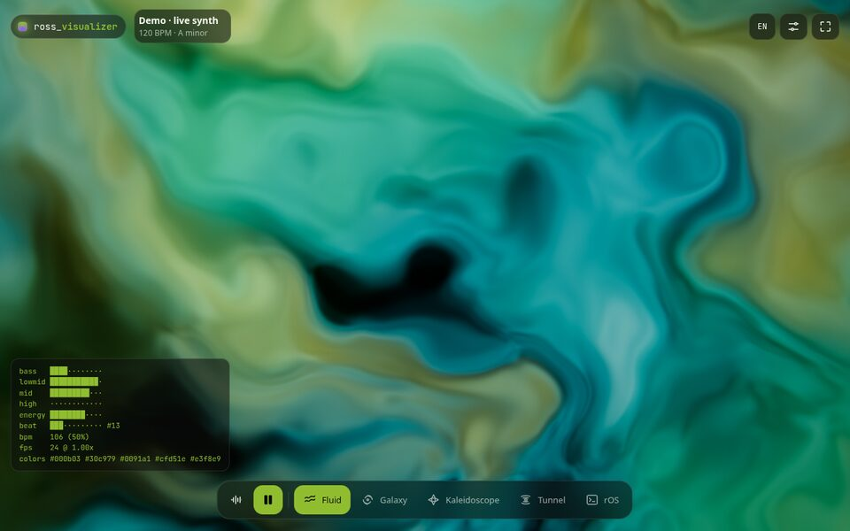
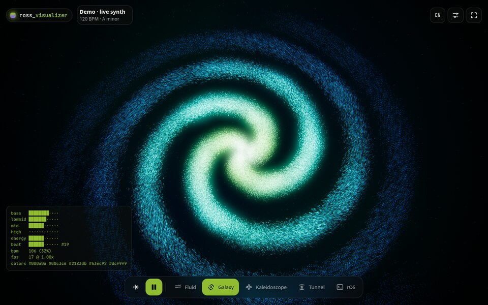
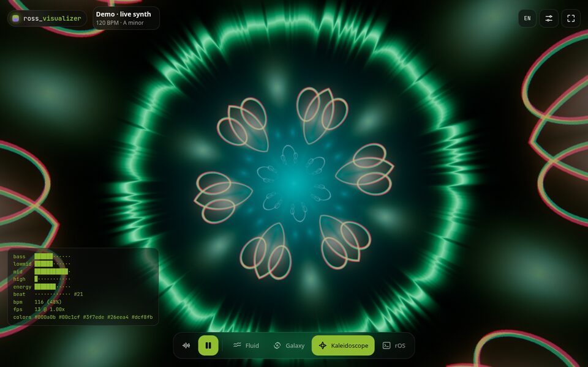
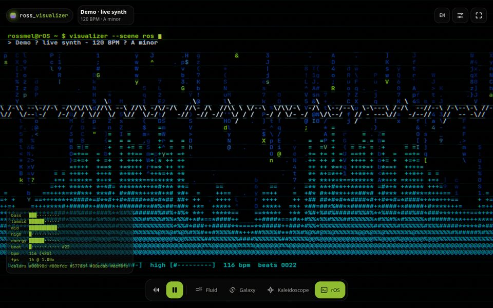
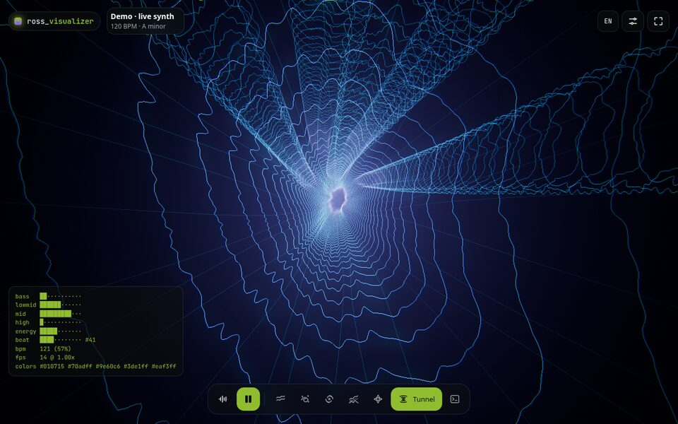
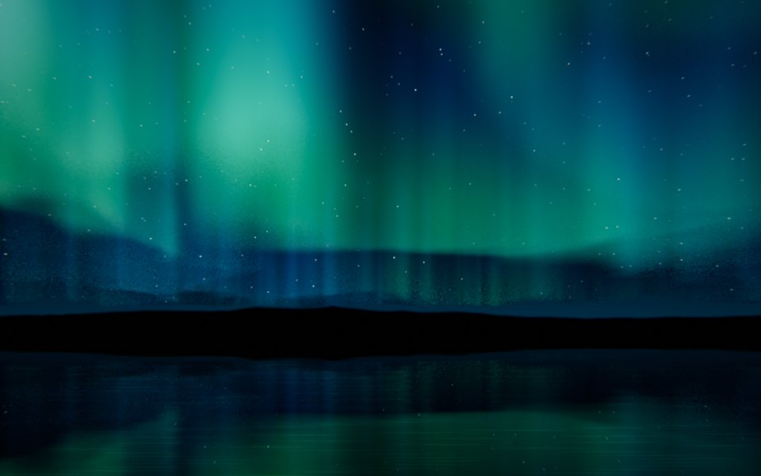
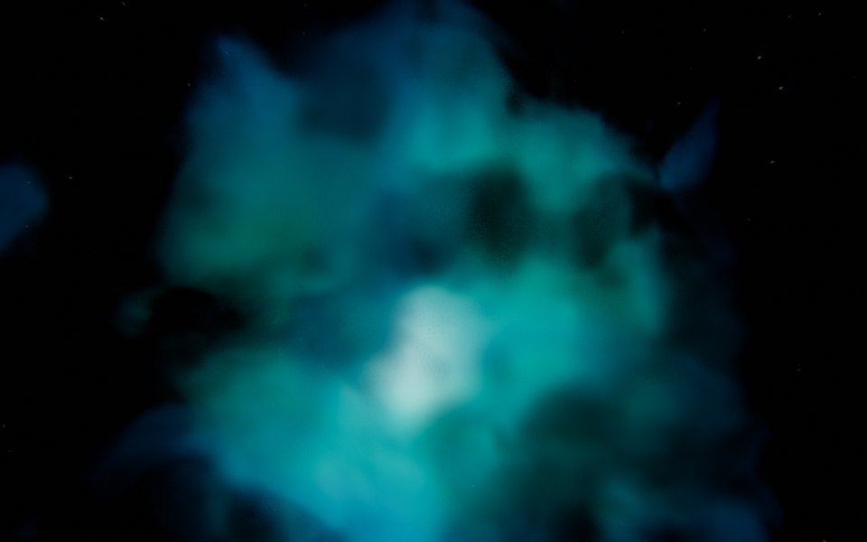

# ross_visualizer

**Your music, turned into light.** A real-time music visualizer for the browser: the colors come from the album art, the motion comes from the sound.

**Live demo → [visualizer.rossmel.com](https://visualizer.rossmel.com)** · [Español](README.es.md)

| Fluid | Galaxy |
| --- | --- |
|  |  |
| **Kaleidoscope** | **rOS** |
|  |  |
| **Tunnel** | **Aurora** |
|  |  |
| **Nebula** | |
|  | |

## What it does

- **Search any song** and it plays the 30-second preview (iTunes Search API, no login) while the visuals take the palette of its cover.
- **Or listen to your own audio**: the microphone, your computer's audio (Chrome/Edge screen-share with "Share audio"), a local file (it reads the embedded cover from MP3/FLAC tags), or a built-in synth track.
- **Seven scenes**, cross-faded: ink poured into water by the music (a real Navier–Stokes fluid solver: each band sprays its own color, beats fire bursts), a volumetric nebula of glowing gas and dark dust, a 120k-particle galaxy that morphs between spiral, barred, ring and elliptical shapes, a volumetric aurora seen from the shore of a lake, a kaleidoscope built from the artwork, a Swiss-cheese tunnel of contour lines that keeps splitting into holes, and a terminal that renders the spectrum in ASCII.
- Works on phones: swipe to change scene, installable as a PWA, keeps the screen awake.
- **Desktop app (Linux)** that listens to everything the computer plays, follows the player that's on (Spotify, a browser…) for the artwork, and adds a click-through **overlay** above every window.

## Desktop app

The same visualizer in a [Tauri](https://tauri.app) app (`src-tauri/`). There's no source to pick: it hears the whole system and paints with the artwork of whatever is playing.

- **Audio**: `pw-record` taps PipeWire's default output and streams raw PCM to the page as binary IPC messages; `src/audio/pcm.ts` does the same Blackman-windowed FFT an `AnalyserNode` does, so the beat detector is shared with the web.
- **What's playing**: `playerctl` follows every MPRIS player and picks the one that's playing; the artwork is fetched natively (no CORS, `file://` works) and the dock's play/next buttons drive that player.
- **Overlay**: a transparent window on the layer-shell *overlay* layer, anchored to the screen edges, with no keyboard focus and an empty input region, so clicks reach the windows underneath. Seven styles: *Halo* (the screen's frame glows, spectrum laid around it), *Horizon* (mirrored bars along the bottom), *Orbit* (a bubble with the kaleidoscope, ringed by the spectrum), *Curtain* (aurora hanging from the top), *Embers*, *rOS rain* and *Wave*. It fades out after a few seconds of silence and stops drawing.

Needs PipeWire (`pw-record`), `playerctl`, `webkit2gtk-4.1` and `gtk-layer-shell` (Wayland compositors with layer-shell: niri, Hyprland, Sway, KDE…).

```sh
npm run desktop                  # dev build with hot reload
scripts/install-desktop.sh       # release build into ~/.local/bin with a launcher
ross-visualizer                  # open the window (it also lives in the tray)
ross-visualizer overlay toggle   # or off | next | prev | halo | horizon | orbit | curtain | embers | rain | wave
```

A running instance picks up these commands, so they work as key bindings, e.g. in niri:

```kdl
Mod+Ctrl+V { spawn "ross-visualizer" "overlay" "toggle"; }
Mod+Ctrl+B { spawn "ross-visualizer" "overlay" "next"; }
```

Nothing is uploaded: all the audio analysis happens in your browser.

## How it works

```
audio source ──► AnalyserNode (FFT 4096) ──► FeatureExtractor ──► uniforms ──► WebGL2 scene ──► bloom + tonemap
album art ──► 64×64 pixels ──► k-means in OKLab ──► 5-role palette ──┘
```

**Audio features** (`src/audio/features.ts`, pure and unit-tested):
- Four bands (bass, low-mid, mid, high) with **automatic gain** per band, so a quiet microphone and a loud file both use the full range, plus attack/release smoothing.
- **Beat detection** with spectral flux on the kick range (40–160 Hz) against an adaptive threshold (mean + 1.6σ over the last 1.5 s), falling back to broadband flux for music without a clear kick.
- **Tempo** from a histogram of inter-onset intervals, folded into 80–180 BPM.
- A 128-bin log spectrum with a +3.6 dB/octave tilt so the highs aren't always flat.

**Palette** (`src/color/palette.ts`): the cover is reduced to 64×64, clustered with deterministic k-means++ in **OKLab** (a perceptual color space), and the clusters are scored by size, chroma and lightness to fill five roles: background, primary, secondary, accent and highlight. Muted covers keep their hue; black-and-white covers get the brand lime as accent. Palettes interpolate in OKLab, so song changes fade instead of jumping.

**Rendering** (`src/gl/`): WebGL2 with half-float targets when available, a quarter-resolution bloom, ACES tonemapping and an adaptive resolution that keeps the frame rate up on phones. The nebula and the aurora are ray-marched volumes; their 3D noise comes from a small random texture (two z-slices per fetch) so they stay at 60 fps. The galaxy has no simulation state: each particle's position is a function of its index and time, computed in the vertex shader. Shaders are GLSL ES 3.00 so they can be reused on OpenGL ES (Android).

## Run it

```sh
npm install
npm run dev      # http://127.0.0.1:5190
npm test         # unit tests (palette, beat/tempo detection, tag parsing)
npm run build
```

`npm run deploy` publishes `dist/` to a host running the nginx container in `deploy/`; it reads the target from a local `.deploy.env` (see `scripts/deploy.sh`).

## Keys

`1`–`7` scenes · `←`/`→` previous/next · `Space` play/pause · `F` fullscreen · `H` hide the interface · `/` search · `O` next overlay style (desktop)

## Roadmap

- Android app with an overlay mode, reading the system's media session.
- More scenes.

## Credits

Previews and artwork from the [iTunes Search API](https://performance-partners.apple.com/search-api). Font: [JetBrains Mono](https://www.jetbrains.com/lp/mono/) (OFL). OKLab by [Björn Ottosson](https://bottosson.github.io/posts/oklab/); domain warping and texture-based 3D noise after [Inigo Quilez](https://iquilezles.org/articles/warp/). The fluid solver is adapted from Pavel Dobryakov's [WebGL Fluid Simulation](https://github.com/PavelDoGreat/WebGL-Fluid-Simulation) (MIT), itself based on *Fast Fluid Dynamics Simulation on the GPU* (GPU Gems). The aurora's look follows the physics notes in Toni Sagristà's [Rendering volume aurorae and nebulae](https://tonisagrista.com/blog/2024/rendering-aurorae-nebulae/).

Made by [Rossmel Abasto](https://portfolio.rossmel.com) · MIT License
